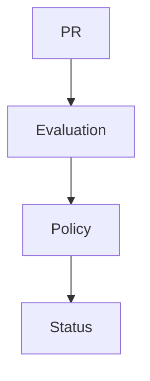

# EvalGate: architecture

CI-native evaluation and cost governance.

Proposed design (not yet verified as implemented):

## Demonstration

Golden dataset regression and failed check. Run only in an isolated local test environment.

## Release criteria

- One-command Docker Compose setup with no mandatory paid API.
- Automated unit and integration tests and CI.
- Prometheus metrics and provisioned Grafana dashboards.
- Reproducible demonstration with captured real telemetry.
- Document measured latency, limitations, and hardware requirements; label simulations separately.
- README architecture, quick start, security boundaries and API examples.
- Never commit credentials or fabricate benchmark results.
